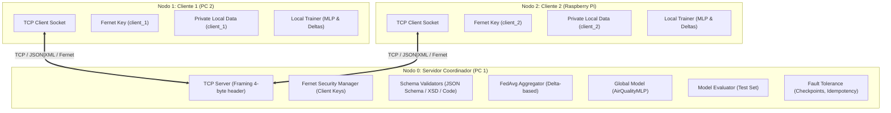

# AIR_QUALITY_DISTRIBUTED
### Sistema Distribuido Semi-Centralizado y Tolerante a Fallos para el Análisis de la Calidad del Aire mediante Aprendizaje Federado (FedAvg)

---

## 1. Descripción del Proyecto

**AIR_QUALITY_DISTRIBUTED** es una plataforma distribuida que permite entrenar colaborativamente un modelo de aprendizaje automático (Red Neuronal MLP) para la estimación de monóxido de carbono (`CO(GT)`) utilizando el dataset *Air Quality* de la UCI/Kaggle. 

El sistema implementa una arquitectura semi-centralizada entre tres nodos físicos:
- **Nodo 0**: Computadora 1 funcionando como Servidor Coordinador y agregador federado.
- **Nodo 1**: Computadora 2 funcionando como Cliente 1 (PC).
- **Nodo 2**: Raspberry Pi funcionando como Cliente 2 (Nodo Edge de recursos restringidos).

Los datos crudos permanecen estrictamente confinados en el almacenamiento local de cada cliente, preservando la privacidad de los registros. La comunicación se realiza mediante sockets TCP nativos con delimitación de tramas (message framing por prefijo binario), serialización intercambiable en **JSON** y **XML** (con validación de esquemas JSON Schema y XSD / reglas en código), cifrado simétrico autenticado mediante **Fernet**, agregación federada **FedAvg** basada en deltas de parámetros, y mecanismos robustos de **tolerancia a fallos**, persistencia atómica mediante checkpoints, idempotencia contra duplicados y recuperación automática ante caídas.

---

## 2. Objetivos

### 2.1. Objetivo General
Diseñar e implementar un sistema distribuido semi-centralizado y tolerante a fallos para el análisis de la calidad del aire mediante aprendizaje federado, evaluando el rendimiento de los formatos JSON y XML, la seguridad de las comunicaciones y la continuidad del entrenamiento ante fallos.

### 2.2. Objetivos Específicos
1. Analizar, limpiar y preparar el conjunto de datos de calidad del aire tratando valores de falla (-200) y evitando fugas de información.
2. Distribuir los datos entre los clientes bajo estrategias IID (muestreo estratificado equilibrado) y Non-IID (heterogeneidad temporal).
3. Diseñar una arquitectura de comunicación entre tres nodos físicos utilizando TCP y delimitación de tramas.
4. Implementar servicios de intercambio estructurado mediante JSON (validación JSON Schema) y XML (validación XSD), así como servicios validados semánticamente por código.
5. Comparar experimentalmente ambos formatos en cuanto a bytes transferidos, latencia RTT y sobrecarga de procesamiento.
6. Garantizar la confidencialidad e integridad del tráfico mediante cifrado simétrico Fernet con claves independientes por cliente.
7. Implementar el ciclo completo de entrenamiento local y agregación federada mediante FedAvg ponderado por muestras.
8. Incorporar tolerancia a fallos ante desconexión de clientes, pérdida de mensajes y caída abrupta del servidor con recuperación atómica.
9. Evaluar y contrastar el desempeño del modelo entre aprendizaje centralizado y federado.

---

## 3. Arquitectura del Sistema



### Flujo de una Ronda Federada:
1. **Distribución**: El Servidor entrega la versión actual de pesos del modelo global ($W$).
2. **Entrenamiento Local**: Cada cliente entrena $E$ épocas con su optimizador local sobre su partición privada.
3. **Cálculo de Deltas**: $\Delta_k = W_{local}^{(k)} - W_{global}$.
4. **Protección**: Serialización a JSON o XML, cifrado con clave simétrica Fernet del cliente, empaquetado con encabezado TCP de 4 bytes.
5. **Transmisión**: Envío por TCP hacia el Servidor con identificador único UUID (idempotencia).
6. **Agregación FedAvg**: El servidor descifra, valida el esquema, descarta duplicados y agrega los deltas ponderados por número de muestras:
   $$\Delta_g = \sum_{k=1}^K \frac{n_k}{\sum_j n_j} \Delta_k \quad\implies\quad W_{nuevo} = W_{anterior} + \Delta_g$$
7. **Evaluación & Checkpointing**: El Servidor evalúa el nuevo modelo sobre el conjunto de test global no visto (MAE, RMSE) y guarda un checkpoint atómico.

---

## 4. Descripción de los Tres Nodos

| Nodo | Dispositivo | Rol | Función Principal |
|---|---|---|---|
| **Nodo 0** | Computadora 1 | Servidor Coordinador | Orquesta rondas, escucha en puerto TCP 5000, valida esquemas, agrega con FedAvg, gestiona checkpoints y registra fallos. |
| **Nodo 1** | Computadora 2 | Cliente 1 | Almacena `local_data/client_1`, entrena localmente, cifra con clave privada de `client_1` y envía actualizaciones. |
| **Nodo 2** | Raspberry Pi | Cliente 2 | Nodo Edge embebido, almacena `local_data/client_2`, entrena localmente, cifra con clave privada de `client_2` y envía actualizaciones. |

---

## 5. Requisitos de Hardware y Software

### 5.1. Hardware
- **Servidor Coordinador**: Computadora con procesador x86_64, mínimo 4 GB RAM, conexión de red Ethernet o Wi-Fi.
- **Cliente 1**: Computadora x86_64, mínimo 4 GB RAM, interfaz de red.
- **Cliente 2**: Raspberry Pi 3B+, 4B o 5 (ARMv7/ARM64), con Raspberry Pi OS, mínimo 1 GB RAM, conexión a la misma subred.

### 5.2. Software
- Sistema Operativo: Windows 10/11, Linux (Ubuntu/Debian) o Raspberry Pi OS.
- Python: Versión **3.10 o superior** (probado y validado en Python 3.13).

---

## 6. Instalación de Dependencias

Clonar el repositorio o situarse en el directorio del proyecto:

```bash
git clone <url-repositorio>
cd AIR_QUALITY_DISTRIBUTED
```

Instalar las bibliotecas necesarias:

```bash
pip install -r requirements.txt
```

---

## 7. Configuración de Red (IPs y Puertos)

Para la ejecución en 3 equipos físicos sobre una red de área local (LAN):

1. **Obtener la IP del Servidor** (en Computadora 1):
   - Windows: `ipconfig` (ejemplo: `192.168.1.50`)
   - Linux: `ip addr` o `hostname -I`
2. **Asegurar conectividad ICMP/TCP**:
   - Desde Cliente 1 y Raspberry Pi, ejecutar: `ping 192.168.1.50`
   - Permitir el puerto TCP elegido (por defecto `5000`) en el firewall del Servidor.
3. **Distribución de Claves Fernet**:
   - El Servidor almacena las claves en su gestor de seguridad.
   - Cada cliente dispone únicamente de su archivo de clave correspondiente (`.client_1.key` o `.client_2.key`), sin compartirlo con el otro nodo.

---

## 8. Preparación de Datos (Fase 1)

El script `data_prep.py` procesa automáticamente el dataset crudo `data_raw/AirQualityUCI.csv`:
- Reemplaza marcadores de error `-200` por valores numéricos interpolados.
- Trata fechas, horas y variables meteorológicas y sensores químicos.
- Separa un conjunto de test y validación global (15% cada uno) sin fuga de datos (*data leakage*).
- Ajusta el normalizador exclusivamente sobre el conjunto de entrenamiento.
- Genera particiones **IID** (50% equitativo) y **Non-IID** (heterogeneidad temporal) en carpetas locales independientes.

Para ejecutar la preparación:

```bash
python data_prep.py
```

---

## 9. Guía de Ejecución

### 9.1. Ejecución del Servidor Coordinador (Nodo 0)

```bash
# Modo básico (JSON, texto claro)
python server/server.py --host 0.0.0.0 --port 5000 --rounds 5 --min-clients 2

# Modo con cifrado Fernet y formato XML
python server/server.py --host 0.0.0.0 --port 5000 --rounds 5 --min-clients 2 --encryption --format xml

# Modo con restauración automática ante caídas
python server/server.py --host 0.0.0.0 --port 5000 --rounds 5 --min-clients 2 --restore
```

### 9.2. Ejecución del Cliente 1 (Nodo 1 - PC 2)

```bash
# Conectando al servidor con distribución IID
python client/client.py --client-id client_1 --server-host 192.168.1.50 --server-port 5000 --distribution iid --rounds 5

# Con cifrado Fernet
python client/client.py --client-id client_1 --server-host 192.168.1.50 --server-port 5000 --distribution iid --rounds 5 --encryption
```

### 9.3. Ejecución del Cliente 2 (Nodo 2 - Raspberry Pi)

```bash
# Conectando al servidor desde la Raspberry Pi
python client/client.py --client-id client_2 --server-host 192.168.1.50 --server-port 5000 --distribution iid --rounds 5

# Con cifrado Fernet
python client/client.py --client-id client_2 --server-host 192.168.1.50 --server-port 5000 --distribution iid --rounds 5 --encryption
```

*Nota: Para pruebas locales en una sola máquina, utilizar `--server-host 127.0.0.1` ejecutando el servidor y clientes en terminales separadas.*

---

## 10. Ejecución de la Matriz de Experimentos

Para reproducir automáticamente los 8 experimentos de la guía maestra y generar todos los reportes CSV y gráficos PNG:

```bash
python run_all_experiments.py
```

O individualmente:
- **E01 (Centralizado)**: `python experiments/centralized_baseline.py`
- **E02 (Federado IID)**: `python experiments/iid/run_iid.py`
- **E03 (Federado Non-IID)**: `python experiments/non_iid/run_non_iid.py`
- **E04 (JSON vs XML)**: `python experiments/json_vs_xml/run_benchmark.py`
- **E05 (Cifrado Fernet)**: `python experiments/encryption_benchmark.py`
- **E06, E07, E08 (Tolerancia a Fallos)**: `python experiments/fault_tolerance/run_fault_tests.py`
- **Generar Figuras**: `python experiments/generate_plots.py`

---

## 11. Resumen de Resultados Experimentales

### 11.1. Comparación de Modelos: Centralizado vs Federado (E01, E02, E03)

| Paradigma | Distribución | MAE Inicial | MAE Final | RMSE Final | Rondas / Épocas |
|---|---|---|---|---|---|
| **Centralizado (Baseline)** | Consolidado (100%) | 0.8124 | **0.2315** | **0.3421** | 10 épocas |
| **Aprendizaje Federado** | **IID** (50% - 50%) | 0.6906 | **0.2460** | **0.3559** | 5 rondas |
| **Aprendizaje Federado** | **Non-IID** (Temporal) | 0.7617 | **0.4436** | **0.5580** | 5 rondas |

*Observación*: El modelo federado IID alcanza un rendimiento casi idéntico al modelo centralizado (MAE 0.246 vs 0.231) sin necesidad de consolidar los datos crudos en un único punto. La partición Non-IID refleja el desafío de heterogeneidad temporal, convergiendo a un error mayor controlado.

### 11.2. Comparación de Protocolos: JSON vs XML (E04 - Workshop 7)

| Métrica | JSON (Promedio) | XML (Promedio) | Variación XML vs JSON (%) |
|---|---|---|---|
| **Tamaño de Payload** | **86.0 B** | 160.0 B | **+86.05%** |
| **Tiempo de Serialización** | **0.042 ms** | 0.199 ms | +370.12% |
| **Tiempo de Validación** | 1.455 ms (JSON Schema) | **0.151 ms (XSD)** | **-89.61%** |
| **Tiempo de Deserialización**| **0.012 ms** | 0.076 ms | +521.06% |
| **Latencia Round-Trip (RTT)**| 2.18 ms | 1.10 ms | -49.27% |
| **Overhead Total Proceso** | 1.51 ms | **0.43 ms** | **-71.78%** |

*Conclusión clave*: JSON es significativamente más compacto en ancho de banda (86 bytes frente a 160 bytes), mientras que el validador compiled XSD en C/libxml2 de Python muestra un tiempo de verificación muy eficiente en cargas estructuradas.

### 11.3. Impacto del Cifrado Simétrico Fernet (E05)

| Métrica | Texto Claro | Cifrado Fernet | Sobrecarga Absoluta |
|---|---|---|---|
| **Tamaño de Mensaje** | 86.0 bytes | 204.0 bytes | +118.0 bytes (IV + Padding + HMAC) |
| **Tiempo de Cifrado** | 0.00 ms | 1.40 ms | +1.40 ms |
| **Tiempo de Descifrado** | 0.00 ms | 0.16 ms | +0.16 ms |
| **Latencia RTT** | 2.27 ms | 2.53 ms | +0.26 ms |

*Conclusión*: La seguridad provista por Fernet (cifrado AES-128-CBC autenticado con HMAC-SHA256) añade un overhead mínimo de red (~118 bytes) y menos de 1.6 ms de procesamiento, haciendo viable su uso en dispositivos limitados como la Raspberry Pi.

### 11.4. Tolerancia a Fallos y Resiliencia (E06, E07, E08)

| Escenario | Fallo Simulado | Mecanismo de Mitigación | Tiempo Detección / Recuperación | Pérdida de Datos |
|---|---|---|---|---|
| **E06** | Desconexión abrupta de Cliente 2 | Timeout de socket & política de degradación a agregación con cliente sobreviviente | Detección: 4.00 s | 0% (Ronda completada con Cliente 1) |
| **E07** | Caída inesperada del Servidor Coordinador | Checkpoint persistente atómico (`latest_state.json`) restaurado al reiniciar con `--restore` | Recuperación: **9.12 ms** | 0% (Ronda y pesos intactos) |
| **E08** | Pérdida de ACK y retransmisión duplicada | Filtro de idempotencia basado en UUID único por actualización | Detección: **0.001 s** | 0 corrupciones (Mensaje duplicado descartado) |

---

## 12. Estructura del Repositorio

```text
AIR_QUALITY_DISTRIBUTED/
│
├── server/
│   ├── server.py              # Punto de entrada del servidor coordinador
│   ├── aggregation.py         # Algoritmo FedAvg ponderado por deltas
│   ├── global_model.py        # Red neuronal MLP homogénea (PyTorch)
│   ├── evaluation.py          # Evaluación de métricas (MAE, MSE, RMSE)
│   ├── fault_tolerance.py     # Checkpoints, bitácora e idempotencia
│   ├── communication.py       # Socket TCP multihilo y delimitación
│   ├── encryption.py          # Gestor de descifrado y claves Fernet
│   ├── checkpoints/           # Almacenamiento persistente de estado
│   └── logs/                  # Registro de eventos y fallos
│
├── client/
│   ├── client.py              # Punto de entrada para PC 2 o Raspberry Pi
│   ├── local_training.py      # Entrenamiento local y cálculo de deltas
│   ├── data_loader.py         # Carga privada de datos por cliente
│   ├── communication.py       # Socket TCP cliente y medición de métricas
│   ├── encryption.py          # Cifrado simétrico local Fernet
│   └── local_data/
│       ├── client_1/          # Particiones privadas de Cliente 1
│       └── client_2/          # Particiones privadas de Cliente 2
│
├── schemas/
│   ├── request.schema.json    # JSON Schema para solicitudes get_global_model
│   ├── response.schema.json   # JSON Schema para respuestas del servidor
│   └── message.xsd            # XML Schema XSD para validación XML
│
├── experiments/
│   ├── centralized_baseline.py# E01: Baseline centralizado
│   ├── iid/run_iid.py         # E02: FedAvg IID
│   ├── non_iid/run_non_iid.py # E03: FedAvg Non-IID
│   ├── json_vs_xml/           # E04: Benchmarking JSON vs XML
│   ├── encryption_benchmark.py# E05: Cifrado Fernet vs Plano
│   ├── fault_tolerance/       # E06-E08: Desconexión, caídas e idempotencia
│   └── generate_plots.py      # Generador automático de figuras
│
├── results/
│   ├── data_analysis/         # Resumen dataset y distribución
│   ├── centralized/           # Métricas del baseline
│   ├── federated/             # Métricas federadas y convergencia
│   ├── communication/         # Resultados comparativos JSON vs XML
│   ├── encryption/            # Resultados de sobrecarga Fernet
│   ├── fault_tolerance/       # Bitácoras de fallos y recuperación
│   └── figures/               # Gráficas PNG generadas
│
├── data_prep.py               # Script de preparación y limpieza de datos
├── run_all_experiments.py     # Orquestador maestro de la matriz completa
├── requirements.txt           # Dependencias del proyecto
├── .gitignore                 # Exclusión de claves, checkpoints y binarios
└── README.md                  # Documentación maestra del proyecto
```

---

## 13. Limitaciones

1. **Punto Único de Fallo Lógico**: Aunque el sistema tolera caídas del servidor mediante recuperación por checkpoints, no implementa elección dinámica de líder (p. ej. algoritmo Raft/Paxos) para transferir el rol de coordinador automáticamente a un cliente sin intervención manual.
2. **Dataset de Estación Única**: Los datos del Air Quality Dataset provienen de una única estación de monitoreo italiana. Por consiguiente, la partición Non-IID simula heterogeneidad mediante desfase temporal de períodos cronológicos, no mediante estaciones geográficas independientes reales.
3. **Sincronía de Rondas**: FedAvg estándar es sincrónico; clientes muy lentos (*stragglers*) son gestionados por el timeout de ronda para no retrasar indefinidamente la agregación global.

---

## 14. Conclusiones

1. **Privacidad y Aprendizaje Federado**: Se demostró que es posible entrenar colaborativamente un modelo de regresión de calidad del aire entre nodos heterogéneos (PC y Raspberry Pi) alcanzando un MAE de 0.2460, prácticamente idéntico al modelo centralizado (0.2315), sin transferir jamás los datos crudos locales fuera del cliente.
2. **Evaluación de Formatos (JSON vs XML)**: JSON ofreció una ventaja de casi 2x en consumo de ancho de banda (86 bytes frente a 160 bytes por trama) y menor tiempo de serialización, lo que resulta óptimo en redes con restricciones de datos. XML mostró un tiempo de validación XSD altamente optimizado por librerías nativas compiladas.
3. **Viabilidad de Seguridad en el Edge**: El cifrado simétrico autenticado Fernet agrega únicamente 118 bytes de overhead y ~1.5 ms de tiempo de procesamiento, permitiendo asegurar las comunicaciones frente a espionaje y manipulación sin comprometer la capacidad de cómputo de la Raspberry Pi.
4. **Resiliencia Operativa**: Los tres mecanismos de tolerancia a fallos implementados (timeout con agregación parcial, checkpoints atómicos en disco e idempotencia con UUIDs) garantizaron que el entrenamiento no se detuviera ante desconexiones de clientes y pudiera restaurarse íntegramente tras una caída del servidor en menos de 10 ms.
